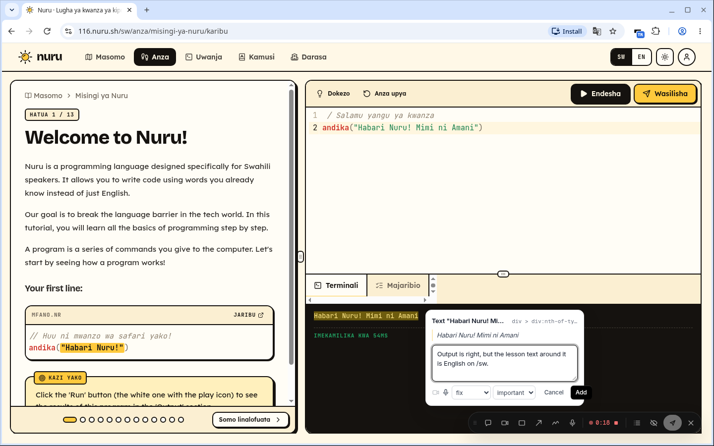

# open-toolbar

Rough software gets better when the people trying it can say exactly what went wrong. open-toolbar records that feedback in full: a session recording, DOM screenshots, annotations on the page, voice notes, and the console and network traces underneath. Your coding agent reads all of it over MCP, an HTTP API or signed webhooks. Point the agent at many pieces of feedback at once and it can work out what the product is meant to be, and write that down for you.

Open source under the MIT license, and self-hosted. Nobody sells it: there are no plans, seats or paid tiers, and it sends no notifications.



`DEMO.md` has screenshots and a two-and-a-half-minute video: a reviewer traces a lesson on Nuru, then Claude Code fixes the bug from the feedback folder.

## Features

- **Annotate the page.** Comment on an element, highlight text, draw a rectangle, an arrow or freehand, or take a screenshot of one element and write on it. Each note carries a locator packet: route and title, candidate route files (SvelteKit and Next.js), visible text, role, ids, classes, nearest heading and the crop.
- **Voice notes.** Attach one to a comment or to the whole trace. The server transcribes it to WebVTT.
- **Comments without a trace.** Each comment still brings the console errors and failed requests of the last 60 seconds.
- **Traces.** Start trace and Stop trace record one tab as interaction spans. A span starts at a reviewer action, collects the requests, console entries, DOM changes and screenshots that follow, and ends with an outcome: `changed`, `error`, `dead`, `stuck` or `silent`. Keyframes come on route changes, annotations and layout changes. SvelteKit data loads and form actions and Next.js RSC requests get their own names.
- **Screenshots and recordings.** Screenshot, tab or screen recording, instant replay of the last minutes, and recording links for people without the extension.
- **A viewer on the server.** Replay, notes, console, network, actions and an Agent tab per capture. Share links last 14 days and can be revoked.
- **Hand-off to agents.** One folder per piece of feedback, written for an agent to read. See [Hand a recording to an agent](#hand-a-recording-to-an-agent).

## Quick start with Docker Compose

You need Docker with Compose and an OIDC provider (see [Sign-in](#sign-in)).

```sh
git clone <this repository> open-toolbar && cd open-toolbar
scripts/gen-secrets.sh https://feedback.example.com   # writes .env with PUBLIC_URL and random secrets
$EDITOR .env                                          # OIDC_ISSUER, OIDC_CLIENT_ID, OIDC_CLIENT_SECRET, ALLOWED_EMAIL_DOMAINS
docker compose up -d --build                          # server on :3000, Postgres, Garage S3, whisper.cpp
curl -s localhost:3000/api/health                     # {"ok":true,...}
```

Put a TLS proxy (Caddy, Traefik, nginx) in front of port 3000 and point `PUBLIC_URL` at the https address. The server refuses to start on a public URL while it still has the dev secrets.

## Coolify

Deploy `docker-compose.coolify.yml` from this repository: + New, this Git repository, Build strategy "Compose", Docker Compose Location `/docker-compose.coolify.yml`. Coolify generates every secret and asks for the four sign-in values before the first deploy. Set the server's domain as `https://feedback.example.com:3000` and register `https://feedback.example.com/api/auth/callback/oidc` with your provider. No service publishes a host port; Coolify's proxy routes the domain.

## Sign-in

Sign-in goes through one generic OIDC provider that you configure with `OIDC_ISSUER`, `OIDC_CLIENT_ID` and `OIDC_CLIENT_SECRET`. Any provider with a discovery document works: Keycloak, Authentik, Okta, Microsoft Entra ID, GitLab and others. `ALLOWED_EMAIL_DOMAINS` decides who gets in, and removing a domain later cuts off its sessions and tokens at their next request.

Google Workspace is a standard OIDC provider, so it needs no special code: use the issuer `https://accounts.google.com`, create an OAuth client of type "Web application" in Google Cloud, and set `ALLOWED_EMAIL_DOMAINS` to your Workspace domain. The server also checks Google's `hd` claim when it is present. `docs/configuration.md`, "Google Workspace", has the steps.

Email and password accounts stay off. They exist only for development and tests, behind `AUTH_DEV_PASSWORD=1`.

## Install the extension

`scripts/release-extension.sh` writes versioned zips to `dist/`. Build with `WXT_SERVER_URL=https://feedback.example.com` so a fresh install already points at your server.

- **Release zip, unpacked.** Unzip `dist/open-toolbar-extension-<version>-chrome.zip`, open `chrome://extensions`, turn on Developer mode, click Load unpacked and pick the folder. The manifest key pins the id `fmongfmimgdafigcahdpofnmmhljpnei`.
- **Unlisted Chrome Web Store item.** Upload `dist/open-toolbar-extension-<version>-chrome-webstore.zip` as an unlisted item and send testers its store link. The item gets its own id; add it to `EXTENSION_IDS` on the server. `docs/extension-release.md` walks through the listing and the review.
- **Firefox.** The zip builds and lints, but sign-in and video do not work there yet.

The extension asks for access to your server only. A workspace admin lists each app under Settings > Projects with its origins and a masking preset. After you sign in, open the extension's popup on one of those apps and click Allow: Chrome asks once for the origins of your projects, and the extension records there and nowhere else. Chrome lets the extension take screenshots of a tab only after you have opened its popup there (or pressed Ctrl+Shift+Y); the toolbar tells you when that is missing.

On a page, Ctrl+Shift+. wakes the reviewer toolbar. Its keys: `c` comment, `t` comment on the selected text, `v` voice note, `x` start or stop a trace.

## The injector, for reviewers without the extension

`apps/injector` is a small Go proxy that adds the toolbar to an app's HTML for signed-in reviewers only, with no change to the app and no extension. Traefik sends it only the requests of chosen hosts that carry the reviewer cookie, plus `/__toolbar/`; every other visitor goes straight to the app. It streams the HTML and changes only the `<head>`, reuses the page's CSP nonce, honours `X-Review-Skip` for automated tests, and passes the response through unchanged on any error. Reviewers start at `https://<app host>/__toolbar/login`. It takes no screenshots, since a page cannot capture its own pixels; the DOM replay covers what the page showed. Setup and Coolify files: `apps/injector/README.md` and `deploy/injector/`.

## Hand a recording to an agent

Create a personal token under Settings > API tokens and give your agent two variables, `TOOLBAR_SERVER` and `TOOLBAR_TOKEN`.

**Share link.** Copy a capture's share link and tell the agent "Fix the problem reported in <share link>". Fetched as Markdown, the link answers with the pull command on its first line, so an agent with the skill (below) needs nothing else.

**One folder, with curl.**

```sh
curl -fsSL -H "Authorization: Bearer $TOOLBAR_TOKEN" "$TOOLBAR_SERVER/api/v1/recordings/<id>/folder" | tar xz
```

You get `.feedback/<id>/`: `README.md` (who, which app and deploy, the reviewer's words, the actions that had no effect, a timeline that names the image for each moment), `feedback.json`, `spans.jsonl`, `annotations/` (crops and locators), `keyframes/`, `outline/`, `text/` (OCR of canvas regions), `voice/`, `console.jsonl`, `network.jsonl` (bodies up to about 256 KB, redacted) and `raw/` (the rrweb recording and a HAR). Every captured string in README.md sits in a fenced block with its source and author, and the agent is told to treat it as data.

**MCP.** The server is a remote MCP server at `/mcp` with OAuth sign-in in the browser; in Claude Code, `claude mcp add --transport http open-toolbar $TOOLBAR_SERVER/mcp`. Settings > MCP has the setup for other agents. Tools include `get_feedback_folder`, `get_feedback_file`, `resolve_feedback`, `list_feedback` and `get_feedback_index`.

**Bulk export, to learn from many.**

```sh
curl -fsSL -H "Authorization: Bearer $TOOLBAR_TOKEN" "$TOOLBAR_SERVER/api/v1/feedback/export" | tar xz
```

This writes `.feedback/INDEX.md` beside one folder per capture. INDEX.md lists every capture with its route, outcome counts and the reviewer's summary, then the routes with the most problems, the errors and failing requests that repeat, and the words reviewers use. Filter with `project`, `status`, `since`, `creator` and others (`docs/configuration.md`, "Agent hand-off").

**The Agent Skill.** Install it in the repository you want fixed. It tells Claude Code, Codex and opencode to pull the folder, read README.md first, open images only when the timeline points at them, and mark the feedback resolved when the fix is in. Its second mode reads the bulk export and writes a product brief.

```sh
# Claude Code (opencode reads this folder too)
mkdir -p .claude/skills/open-toolbar-feedback
curl -fsSL "$TOOLBAR_SERVER/api/v1/skill" -o .claude/skills/open-toolbar-feedback/SKILL.md
# Codex and opencode
mkdir -p .agents/skills/open-toolbar-feedback
curl -fsSL "$TOOLBAR_SERVER/api/v1/skill" -o .agents/skills/open-toolbar-feedback/SKILL.md
```

**Webhooks.** Settings > Webhooks sends signed `feedback.created` events (with the folder URL and pull command) and `feedback.resolved` events (with the agent's note and commit).

In tests on real bugs, Claude Code, Codex and opencode each found the cause from the folder alone: `docs/agent-handoff-results.md`.

## Configuration

Five values make a working server: `PUBLIC_URL`, `BETTER_AUTH_SECRET`, `OIDC_ISSUER`, `OIDC_CLIENT_ID` with `OIDC_CLIENT_SECRET`, and `ALLOWED_EMAIL_DOMAINS`. Everything else has a default. `docs/configuration.md` documents every variable with its default, an example and when to change it.

## Branding

Set the instance's name, logo and accent colour with `APP_NAME`, `APP_LOGO_URL` and `APP_ACCENT`, or in Settings > Server. Your brand shows on the sign-in page, share pages, the dashboard and the signed-in extension. `WXT_APP_NAME` and `WXT_APP_ICON` build an extension with your name and icon. Details: `docs/branding.md`.

## Transcription

Voice notes become WebVTT transcripts on your server. Pick the provider with `TRANSCRIBE_PROVIDER`:

- `local` (default): whisper.cpp in the `whisper` compose service. No key, no cost, and no audio leaves your server. Good for English; its Swahili is unreadable.
- `openai`: OpenAI's `gpt-transcribe`, or any OpenAI-compatible endpoint (`TRANSCRIBE_BASE_URL`, for example Groq). Set `OPENAI_API_KEY` or `TRANSCRIBE_API_KEY`. Far better on Swahili and mixed Swahili and English, and faster than whisper.cpp on a CPU.
- `none`: no transcripts.

Limits of the hosted provider: OpenAI takes at most 25 MB per request, so the server cuts the voice track at pauses into chunks of 30 s or less, and recording length is bounded only by `TRANSCRIBE_MAX_MINUTES` (60). `gpt-transcribe` costs $0.0045 a minute: a five-minute note is about $0.02, an hour about $0.28. `TRANSCRIBE_MONTHLY_MINUTES` caps a month's hosted audio. Only the microphone audio goes to the provider: no video, screenshots, console, network data or names.

## Privacy and masking

- Redaction runs in the extension's isolated world before anything leaves the page: `Authorization`, `Cookie`, `Set-Cookie`, `X-Api-Key` and headers matching `token|secret|key` go, as do password and token fields; JWTs, email addresses and card numbers are scrubbed.
- Each project picks a masking preset. **Staging, own team** keeps text unmasked and keeps bodies for the app's own API. **Production** masks all text and inputs, blocks media, and keeps bodies only for allowlisted URLs. The preset is written into each feedback folder's header.
- Share links use a 128-bit token in the path, expire after 14 days (`SHARE_LINK_DAYS`), can be revoked, and send `Referrer-Policy: no-referrer` and `X-Robots-Tag: noindex`. A share link shows a summary; the full folder needs a personal token of a workspace member.
- The extension holds no client secret. It signs in through `chrome.identity.launchWebAuthFlow` against your server, and every record stores who left it: issuer, subject, email and name.

## Paused

These stay in the code behind flags that default to off, with their UI hidden: GitHub and GitLab issue integrations (`FEATURE_TRACKERS`), Slack (`FEATURE_SLACK`), the command-line tool (`FEATURE_CLI`), notification and invite mail (`FEATURE_EMAIL`), AI titles, steps and chapters (`FEATURE_AI`), data retention and audit logs (`FEATURE_ADMIN_EXTRAS`), and social, magic-link and password sign-in. `docs/scope.md` explains why.

## Development

`docs/dev.md` covers the layout, ports, the mock OIDC provider of the `dev` compose profile, dev mode with hot reload, builds, unit tests and the e2e suites. Short version:

```sh
pnpm install
pnpm stack        # Postgres, Garage, whisper and the mock OIDC provider in Docker
pnpm dev          # server on :3000 and the extension watch build
pnpm -r test      # unit tests
```

More docs:

- `docs/configuration.md`: every environment variable, the basic deployment, Coolify
- `docs/extension-release.md`: extension zips, the Chrome Web Store item and its id, Firefox
- `docs/branding.md`: name, logo, accent colour and the branded extension
- `docs/agent-handoff-results.md`: how three agents did with real feedback folders
- `docs/architecture.md` and `docs/decisions.md`: how it is built and why
- `docs/status.md`, `PLAN.md` and `PROGRESS.md`: what is built and where work stands

## License

MIT. See `LICENSE`.
